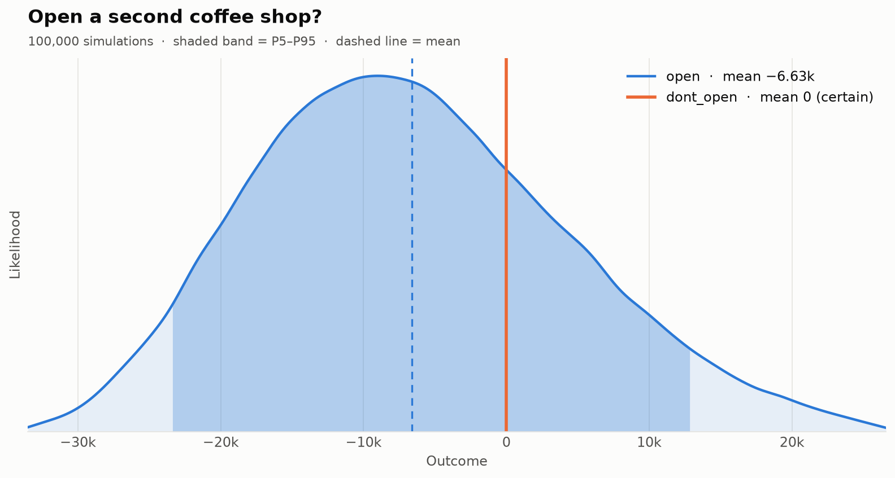
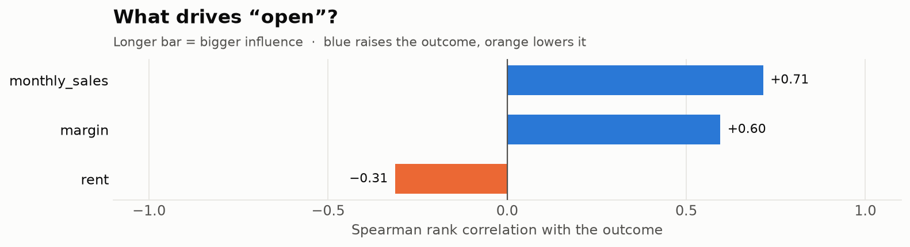
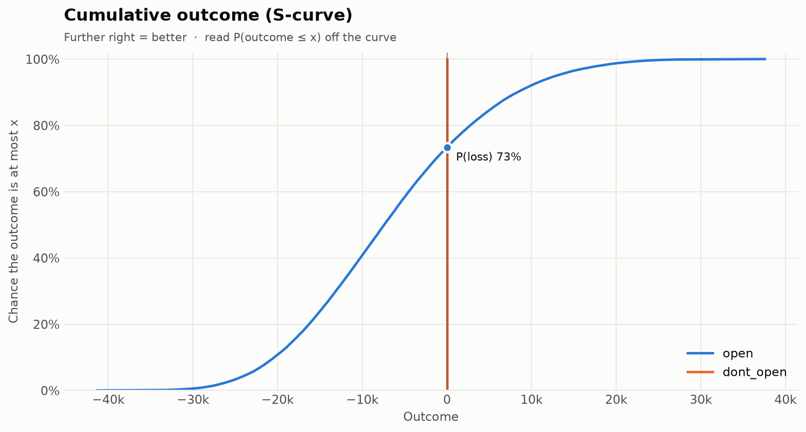
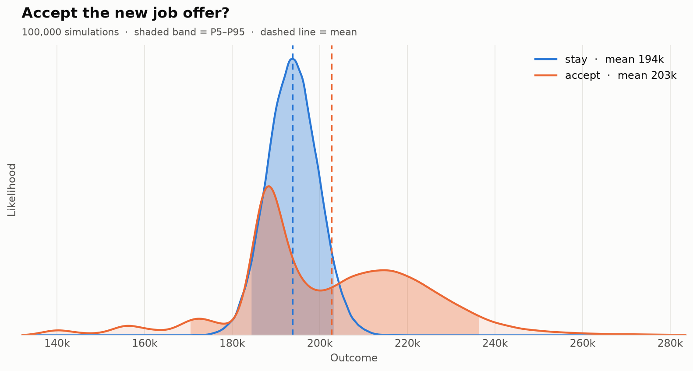
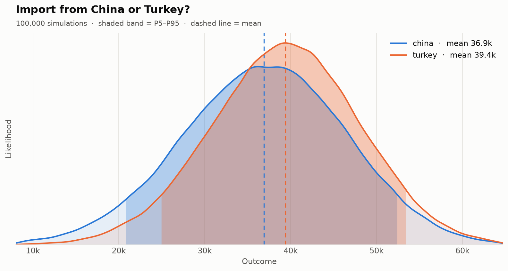

<h1 align="center">montecarlo-hermes</h1>

<p align="center"><b>🎲 Simulate your decisions before you make them.</b></p>

<p align="center">
  <a href="https://pypi.org/project/montecarlo-hermes/"></a>
  <a href="https://pypi.org/project/montecarlo-hermes/"></a>
  <a href="https://github.com/tetttet/montecarlo-hermes/actions/workflows/ci.yml"></a>
  <a href="https://codecov.io/gh/tetttet/montecarlo-hermes"></a>
  <a href="https://github.com/tetttet/montecarlo-hermes/blob/main/LICENSE"></a>
</p>

<p align="center">
  <picture>
    <source media="(prefers-color-scheme: dark)" srcset="https://raw.githubusercontent.com/tetttet/montecarlo-hermes/main/docs/assets/coffee_shop_dark.png">
    
  </picture>
</p>

Describe a decision: a few **options**, the **uncertain inputs** and a **formula** for the
outcome of each option. **montecarlo-hermes** runs 100,000 possible futures in a fraction of a
second and tells you which option wins, how often you would lose money, and which unknowns
matter most.

The chart above answers *"Should I open a second coffee shop?"* The gut says yes. The
simulation says there is a **73% chance of losing money** in the first year.

## Why

- **Decisions, not just simulations.** You get a recommendation, the probability that each
  option is best, its downside (VaR/CVaR) and expected regret, without writing any statistics
  code.
- **Pandas-level easy.** Declare variables, write the formula as you would on a whiteboard,
  call `run()`. Everything is vectorized NumPy, so 100k samples take milliseconds.
- **Works without Python.** Put the decision in a YAML file, run `mchermes run`, and share
  the table, the JSON or the chart.

## Install

```bash
pip install montecarlo-hermes
```

Optional pandas export: `pip install "montecarlo-hermes[pandas]"`. Requires Python 3.10+.

## 30-second quickstart

```python
import mchermes as mc

d = mc.Decision("Open a second coffee shop?", n=100_000, seed=42)
rent   = d.uncertain("rent", mc.Normal(3000, 300))
sales  = d.uncertain("monthly_sales", mc.Triangular(8000, 12000, 18000))
margin = d.uncertain("margin", mc.Uniform(0.25, 0.4))

d.option("open",      lambda: sales * margin * 12 - rent * 12 - 20_000)
d.option("dont_open", lambda: 0)

r = d.run()
r.summary()              # rich table in the terminal
r.best_option()          # 'dont_open'
r.prob_loss("open")      # 0.7336
r.plot()                 # the chart above
r.plot_tornado("open")   # what drives the result?
r.to_dataframe()         # every sample, if pandas is installed
```

```text
Open a second coffee shop?
┏━━━━━━━━━━━━━┳━━━━━━━━━┳━━━━━━━━━━━━━┓
┃ Metric      ┃    open ┃ ★ dont_open ┃
┡━━━━━━━━━━━━━╇━━━━━━━━━╇━━━━━━━━━━━━━┩
│ Mean        │  -6,634 │           0 │
│ Median      │  -7,409 │           0 │
│ Std dev     │  11,041 │           0 │
│ P5          │ -23,438 │           0 │
│ P10         │ -20,400 │           0 │
│ P90         │   8,342 │           0 │
│ P95         │  12,916 │           0 │
│ Min         │ -41,312 │           0 │
│ Max         │  37,548 │           0 │
│ P(loss)     │   73.4% │        0.0% │
│ VaR 95%     │ -23,438 │           0 │
│ CVaR 95%    │ -26,616 │           0 │
│ P(best)     │   26.6% │       73.4% │
│ Exp. regret │   8,667 │       2,032 │
└─────────────┴─────────┴─────────────┘
100,000 samples · seed 42 · criterion expected_value
Recommendation: dont_open  (expected 0, P(loss) 0.0%, best in 73.4% of scenarios)
```

Variables behave like NumPy arrays holding every sample, so `np.maximum(sales, 10_000)`,
`np.where(rent > 3200, ...)` and any other vectorized expression work inside an option. The
same seed always gives identical results.

## YAML + CLI quickstart

```yaml
# examples/coffee_shop.yaml
name: Open a second coffee shop?
samples: 100000
seed: 42
variables:
  rent: {dist: normal, mean: 3000, std: 300}
  monthly_sales: {dist: triangular, low: 8000, mode: 12000, high: 18000}
  margin: {dist: uniform, low: 0.25, high: 0.4}
options:
  open: "monthly_sales * margin * 12 - rent * 12 - 20000"
  dont_open: "0"
```

```bash
mchermes init                                   # write an example decision.yaml
mchermes run examples/coffee_shop.yaml          # table + recommendation
mchermes run examples/coffee_shop.yaml --plot coffee.png --theme dark
mchermes run examples/coffee_shop.yaml --json   # machine-readable output
mchermes run examples/job_offer.yaml -c risk_averse -n 1000000 --seed 1
```

YAML formulas are **never passed to `eval`**. They are parsed with `ast` and only numbers,
variable names, arithmetic (`+ - * / // % **`), comparisons, `and`/`or`/`not` and the functions
`min`, `max`, `where`, `abs`, `log`, `exp` and `sqrt` are allowed. Anything else, such as
`__import__`, attribute access or other function calls, is rejected with a clear error. A plain
number in `variables` is a fixed value.

## Features

- 9 distributions with parameter validation and analytic `mean`/`std`
- Vectorized simulation: formulas run on all samples at once
- Reproducible: each variable has its own random stream derived from `(seed, name)`, so adding
  a variable never changes the draws of the others
- Risk metrics, three decision criteria and Spearman tornado sensitivity
- Charts in light and dark themes: distributions, tornado and S-curve
- Rich terminal table, JSON output and pandas export
- Fully typed (`mypy --strict`), 99% test coverage

### Distributions

| Distribution | Python | YAML | Use it for |
|---|---|---|---|
| Normal | `mc.Normal(mean, std)` | `{dist: normal, mean, std}` | Symmetric noise around a best guess |
| LogNormal | `mc.LogNormal(mean, std)` | `{dist: lognormal, mean, std}` | Positive, right-skewed amounts (equity, claims) |
| Uniform | `mc.Uniform(low, high)` | `{dist: uniform, low, high}` | "Somewhere between" with no favorite |
| Triangular | `mc.Triangular(low, mode, high)` | `{dist: triangular, low, mode, high}` | Quick three-point estimates |
| PERT | `mc.PERT(low, mode, high)` | `{dist: pert, low, mode, high}` | Smoother three-point estimates |
| Beta | `mc.Beta(alpha, beta, low=0, high=1)` | `{dist: beta, alpha, beta}` | Rates and shares |
| Bernoulli | `mc.Bernoulli(p)` | `{dist: bernoulli, p}` | "Event happens with probability p" (1 or 0) |
| Discrete | `mc.Discrete(values, probabilities)` | `{dist: discrete, values, probabilities}` | A few known scenarios |
| Fixed | `mc.Fixed(value)` | `value` or `{dist: fixed, value}` | Known constants |

`mc.LogNormal` takes the mean and std of the variable itself. Use
`mc.LogNormal.from_log_params(mu, sigma)` for the parameters of `log(X)`.

### Metrics

| Metric | Attribute | Meaning |
|---|---|---|
| Mean, median, std | `mean`, `median`, `std` | Center and spread of the outcome |
| Min / max | `min`, `max` | Most extreme simulated outcomes |
| Percentiles | `p5`, `p10`, `p50`, `p90`, `p95` | E.g. P10: 90% of futures are better than this |
| Probability of loss | `prob_loss` | P(outcome < 0); `r.prob_loss(opt, threshold)` for other cut-offs |
| VaR 95% | `var_95` | The 5th percentile: you do at least this well with 95% confidence |
| CVaR 95% | `cvar_95` | Average of the worst 5% of outcomes |
| Probability best | `prob_best` | Share of futures in which this option beats all others |
| Expected regret | `expected_regret` | Average shortfall against the best option in each future |

All metrics are in outcome units, so a negative VaR means a loss. Read them with
`r.stats["open"].cvar_95`, `r.to_dict()` or `r.to_dataframe("summary")`.

**Decision criteria** for `r.best_option(criterion)` (or `Decision(..., criterion=...)`):

| Criterion | Picks the option that... |
|---|---|
| `expected_value` (default) | has the highest mean |
| `risk_averse` | has the highest P10, the best "bad case" |
| `min_regret` | has the lowest expected regret |

Criteria can disagree, and that is usually the interesting part. In the
[job offer example](examples/job_offer.yaml), `accept` wins on expected value and regret, but
`stay` wins under `risk_averse` because of the layoff risk.

## Gallery

<table>
  <tr>
    <td width="50%">
      <picture>
        <source media="(prefers-color-scheme: dark)" srcset="https://raw.githubusercontent.com/tetttet/montecarlo-hermes/main/docs/assets/coffee_shop_tornado_dark.png">
        
      </picture>
      <p align="center"><b>Tornado</b>: <code>r.plot_tornado("open")</code></p>
    </td>
    <td width="50%">
      <picture>
        <source media="(prefers-color-scheme: dark)" srcset="https://raw.githubusercontent.com/tetttet/montecarlo-hermes/main/docs/assets/coffee_shop_cdf_dark.png">
        
      </picture>
      <p align="center"><b>S-curve</b>: <code>r.plot_cdf()</code></p>
    </td>
  </tr>
  <tr>
    <td width="50%">
      <picture>
        <source media="(prefers-color-scheme: dark)" srcset="https://raw.githubusercontent.com/tetttet/montecarlo-hermes/main/docs/assets/job_offer_dark.png">
        
      </picture>
      <p align="center"><b>Job offer</b>: safe vs. higher but riskier pay</p>
    </td>
    <td width="50%">
      <picture>
        <source media="(prefers-color-scheme: dark)" srcset="https://raw.githubusercontent.com/tetttet/montecarlo-hermes/main/docs/assets/import_business_dark.png">
        
      </picture>
      <p align="center"><b>Import business</b>: China vs. Turkey</p>
    </td>
  </tr>
</table>

Every image is produced by running the examples: `python scripts/generate_assets.py`.

## Examples

Each example is available as a YAML file and a Python script that give identical results.

| Example | Question | Files |
|---|---|---|
| Coffee shop | Open a second location or not? | [YAML](examples/coffee_shop.yaml) · [Python](examples/coffee_shop.py) |
| Job offer | Stay, or take an offer with an uncertain bonus, equity and layoff risk? | [YAML](examples/job_offer.yaml) · [Python](examples/job_offer.py) |
| Import business | Buy from China or Turkey, given price, shipping, customs and delay risk? | [YAML](examples/import_business.yaml) · [Python](examples/import_business.py) |

## Roadmap

- [ ] Correlated inputs (Gaussian copula); the sampling extension point is already in place
- [ ] Web UI for building and sharing decisions
- [ ] Jupyter widgets: sliders on inputs with live charts
- [ ] Integration with the HERMES decision platform
- [ ] More distributions (Gamma, Poisson, empirical data) and time-series options

Ideas and votes are welcome in [issues](https://github.com/tetttet/montecarlo-hermes/issues).

## Contributing

Contributions are welcome. See [CONTRIBUTING.md](CONTRIBUTING.md) for the dev setup and checks
(`ruff`, `mypy`, `pytest`). If montecarlo-hermes helped you make a call, a ⭐ helps others find
it.

## License

[MIT](LICENSE)
