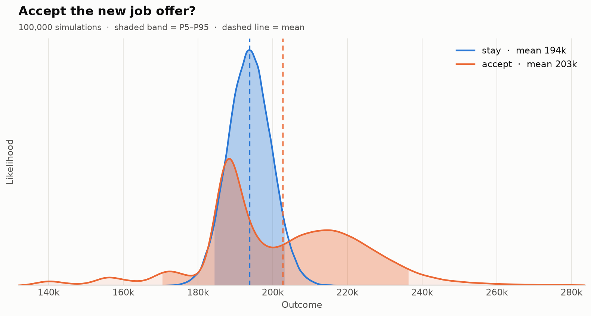
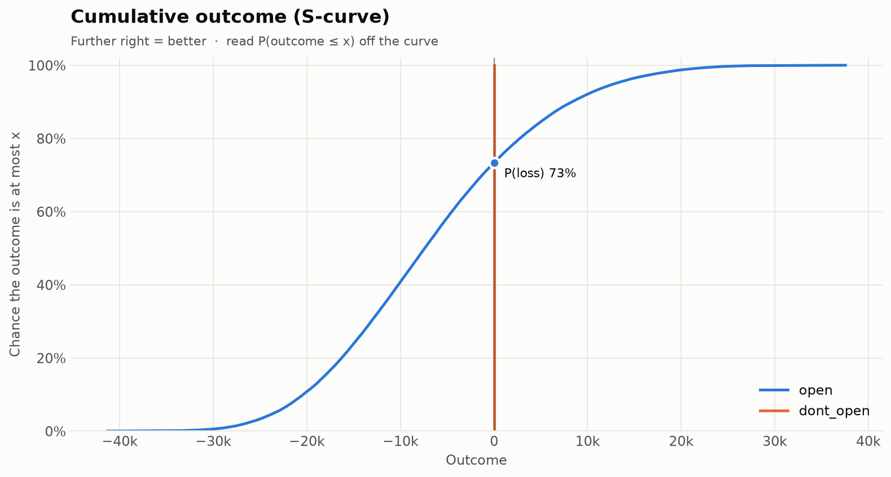

# Charts and reports

## Charts

```python
r.plot()                          # distribution overlay
r.plot_tornado("open")            # drivers
r.plot_cdf()                      # cumulative S-curve
d.sweep("price", values).plot()   # what-if curves

r.plot("chart.png", theme="dark") # save; light or dark theme
```

Every chart function returns a Matplotlib `Figure`, so you can keep customizing it. Passing a path saves the figure (PNG, SVG, PDF, ...) and closes it.

| Distributions | S-curve |
|---|---|
|  |  |

## HTML report

```python
r.to_html("report.html")
```

```bash
mchermes run decision.yaml --html report.html
```

A single self-contained file you can email or attach to a ticket:

- the recommendation, with key numbers;
- distribution, S-curve and tornado charts as crisp SVG, with a light/dark toggle;
- the full metrics table, value of information and an input summary;
- no external requests, and it prints cleanly.

[Open an example report](../examples/job_offer_report.html).

## Notebooks

In Jupyter, a `Result` displays as an HTML table with the recommendation. See [`examples/quickstart.ipynb`](https://github.com/tetttet/montecarlo-hermes/blob/main/examples/quickstart.ipynb).

## Data exports

```python
r.to_dict()                    # JSON-ready: metrics, sensitivities, EVPI, EVPPI
r.to_csv("samples.csv")        # one row per sample, no pandas needed
r.to_csv("summary.csv", kind="summary")
r.to_dataframe()               # pandas: one row per sample
r.to_dataframe("summary")      # pandas: one row per option
```
