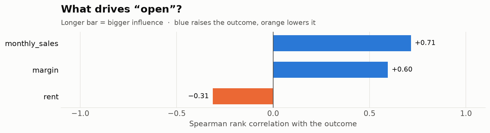

# Sensitivity and value of information

## Tornado: what moves the outcome?

```python
r.sensitivity("open")
# [Sensitivity(variable='monthly_sales', spearman=0.71),
#  Sensitivity(variable='margin', spearman=0.60),
#  Sensitivity(variable='rent', spearman=-0.31)]
r.plot_tornado("open")
```

Each input's Spearman rank correlation with the outcome, sorted by absolute size. Positive inputs push the outcome up, negative ones push it down. Inputs that never vary are skipped. Correlations are estimated on at most 200,000 samples (standard error below 0.003), which keeps multi-million-sample runs fast.



## Value of information: what is worth finding out?

Sensitivity tells you what moves the outcome. **Value of information** tells you what would change your *decision*, and what that is worth in outcome units.

```python
r.evpi()                    # 2,032: a perfect forecast of everything
r.value_of_information()    # EVPPI per input
# monthly_sales  1,043  (51% of EVPI)
# margin           495  (24%)
# rent              44   (2%)
```

- **EVPI** (expected value of perfect information) is the most you should pay for a perfect forecast of every input before deciding. It equals E[best option in each future] − E[best option on average].
- **EVPPI** (partial) is the same for one input. In this example, a market study that pins down monthly sales is worth up to about 1,043. Researching rent is barely worth anything: whatever the rent turns out to be, the decision stays the same.

If an input has high sensitivity but low EVPPI, it moves the outcome without changing which option is best.

EVPPI is estimated by grouping futures into quantile bins of the input (or by exact value for discrete inputs) and checking how much better you would choose within each group.
