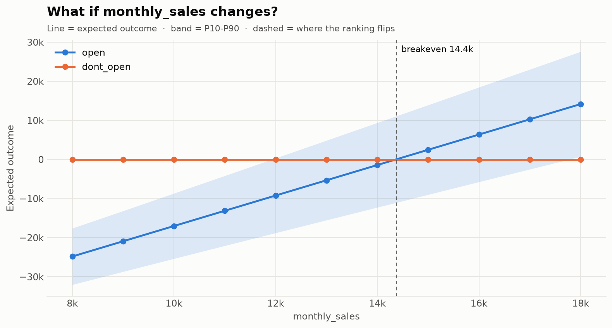

# What-if analysis

## Sweeps and breakeven

How does the decision change if one input were known? `sweep()` fixes a variable at each value and re-runs everything with the same seed. All runs see the same futures, so the curves are smooth.

```python
import numpy as np

sweep = d.sweep("monthly_sales", np.linspace(8000, 18000, 11))
sweep.best_options()                  # ['dont_open', ..., 'open', 'open']
sweep.breakeven("open", "dont_open")  # ≈ 14,371
sweep.plot()
sweep.to_dataframe()
```



The analytic breakeven is 56,000 / (12 × 0.325) ≈ 14,359. Opening pays off only if average monthly sales reach about 14,400.

From the command line:

```bash
mchermes sweep coffee_shop.yaml monthly_sales 8000 18000 --steps 11 --plot sweep.png
```

## Conditional results

`given()` keeps only the futures where a condition holds. The result is a full `Result` with every metric, chart and export.

```python
good_year = r.given("monthly_sales > 14000")
good_year.best_option()      # 'open'
good_year.prob_loss("open")  # 0.37
```

Conditions are safe formulas over input **and** option names, for example `"rent > 3300 and margin < 0.3"` or `"open < -20000"`. That last one asks "what do the worst futures for opening look like?". You can also pass a boolean NumPy array.

```bash
mchermes run coffee_shop.yaml --given "monthly_sales > 14000"
```
