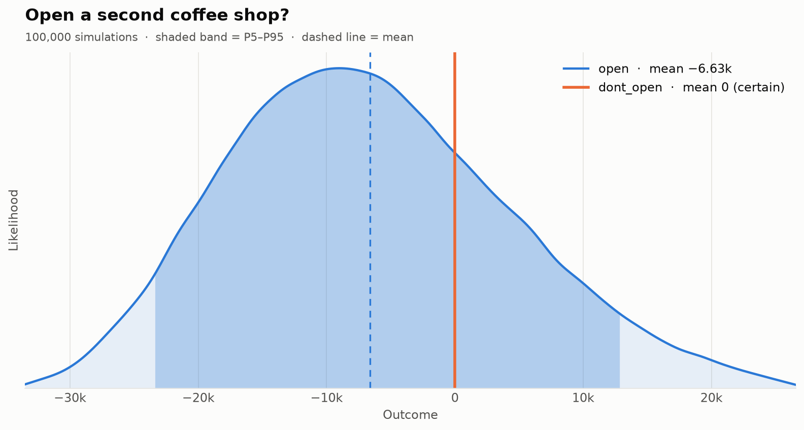

# montecarlo-hermes

**🎲 Simulate your decisions before you make them.**

Describe a decision: a few **options**, the **uncertain inputs**, and a **formula** for the outcome of each option. montecarlo-hermes simulates thousands of possible futures and tells you which option wins, how often you would lose money, which unknowns matter most, and what it would be worth to learn them first.



```python
import mchermes as mc

d = mc.Decision("Open a second coffee shop?", n=100_000, seed=42)
rent   = d.uncertain("rent", mc.Normal(3000, 300))
sales  = d.uncertain("monthly_sales", mc.Triangular(8000, 12000, 18000))
margin = d.uncertain("margin", mc.Uniform(0.25, 0.4))

d.option("open",      lambda: sales * margin * 12 - rent * 12 - 20_000)
d.option("dont_open", lambda: 0)

r = d.run()
r.summary()
```

## What you get

| | |
|---|---|
| **Recommendation** | `best_option()` with three criteria: expected value, risk-averse, minimum regret |
| **Risk** | P(loss), percentiles, VaR and CVaR, probability each option is best, expected regret |
| **Drivers** | Spearman tornado sensitivity per option |
| **Value of information** | EVPI and EVPPI: what a forecast of each input is worth |
| **What-if** | parameter sweeps with breakeven points, conditional results with `given()` |
| **Realism** | 16 distributions, correlated inputs, empirical data |
| **Output** | rich terminal table, charts in light and dark themes, a standalone HTML report, JSON, CSV, pandas |
| **No-code** | YAML files and the `mchermes` command line |

Install it with `pip install montecarlo-hermes`, then continue with [Getting started](getting-started.md).
